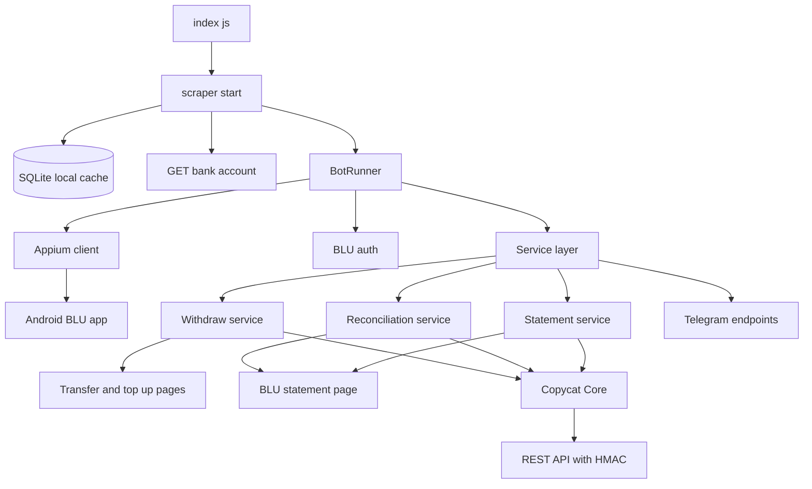
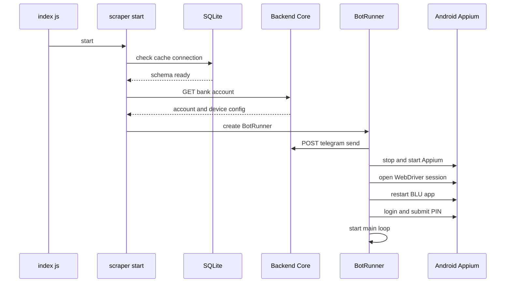
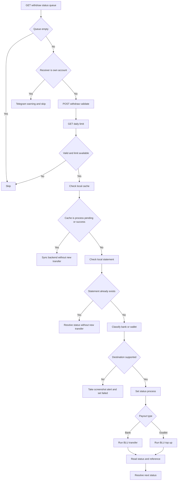
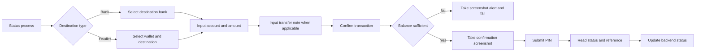
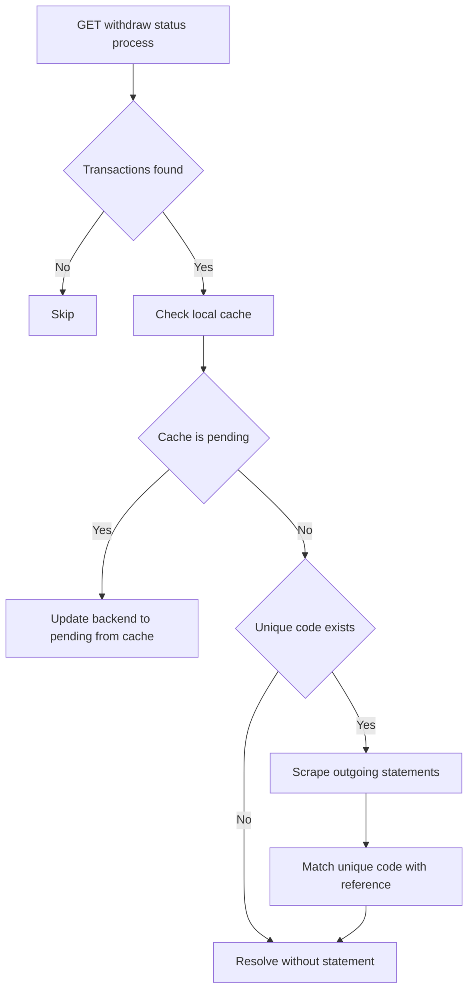
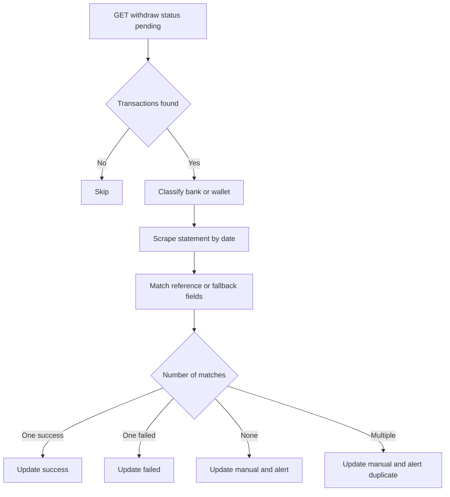
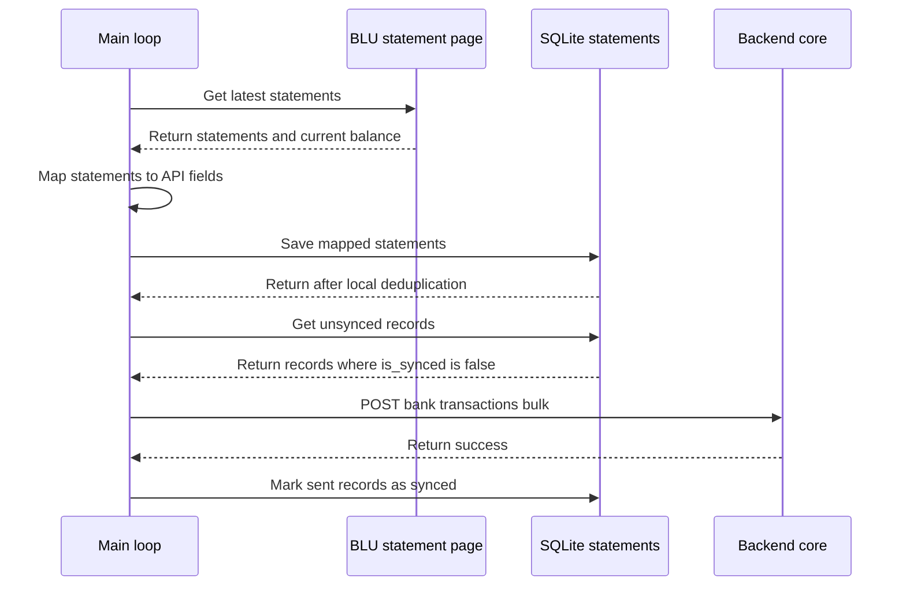
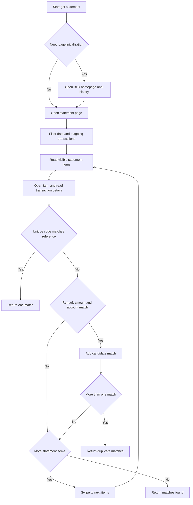

# TRD-2026-013: Repository blu-by-bca-scraper — Bot Otomasi Scraping & Payout BLU by BCA

# Technical Requirements Document (TRD)

|     |     |
|-----|-----|
| **Nama Proyek** | Repository `blu-by-bca-scraper` — Bot Otomasi Scraping & Payout BLU by BCA |
| **Kode / ID** | TRD-2026-013 |
| **Versi Dokumen** | 0\.1 |
| **Status** | Approved |
| **Penulis** | Anggy Dian Pratama |
| **Tanggal Dibuat** | 2026-10-13 |
| **Terakhir Diperbarui** | 2026-10-13 |
| **Target Rilis** | Continuous |


---

## 1. Ringkasan Eksekutif

Repository `blu-by-bca-scraper` adalah bot Node.js berbasis ES Modules yang mengotomasi aplikasi blu BCA Digital pada perangkat Android melalui Appium dan WebDriverIO. Sistem menjalankan payout atau withdraw, rekonsiliasi status transaksi berdasarkan mutasi rekening, dan sinkronisasi statement ke backend Copycat Scraper Payout Core.

Bot berinteraksi dengan aplikasi BLU melalui UI automation dan backend core melalui REST API dengan autentikasi HMAC-SHA256. Proses utama berjalan dalam infinite loop dengan jeda antar-siklus.

## 2. Latar Belakang & Konteks

Backend menyediakan antrean withdraw, data rekening, validasi transaksi, dan endpoint update status. Bot mengambil antrean, melakukan transfer atau top-up di aplikasi BLU, membaca hasil transaksi, menyimpan cache lokal untuk mencegah double transfer, mengirim notifikasi dan bukti, serta menyinkronkan mutasi rekening.

## 3. Tujuan & Non-Tujuan

### Tujuan (Goals)

* Mengotomasi siklus hidup withdraw: `queue → process → pending → success/failed/manual`.
* Mencegah double transfer melalui cache lokal, validasi backend, dan pencocokan mutasi.
* Menyinkronkan mutasi rekening BLU ke backend secara idempotent.
* Menyediakan audit trail berupa screenshot dan notifikasi Telegram.
* Menjaga PIN, API key, dan secret tidak masuk ke log.

### Non-Tujuan (Non-Goals)

* Tidak membuat atau mengubah endpoint backend.
* Tidak menjalankan multi-tenancy dalam satu proses.
* Tidak melakukan pencairan dana di luar alur aplikasi BLU.

## 4. Stack Teknologi

| Layer | Teknologi | Versi | Keterangan |
|-------|-----------|-------|------------|
| Runtime | Node.js   | ES Modules (`type: module`) | Runtime JavaScript |
| UI Automation | Appium    | ^3.7.0 | Driver automation Android |
| Appium Driver | appium-uiautomator2-driver | ^8.7.0 | Android UIAutomator2 |
| WebDriver Client | webdriverio | ^9.8.0 | Client sesi Appium |
| HTTP Client | axios     | ^1.6.8 | REST API client |
| Local DB | sqlite3 + knex | ^5.1.7 / ^3.0.1 | Cache lokal |
| Image Processing | sharp     | ^0.34.3 | Kompresi screenshot |
| OCR   | tesseract.js | ^5.0.5 | OCR bila diperlukan |
| Date Utility | dayjs, moment | ^1.11.23 / ^2.30.1 | Utilitas tanggal |
| Testing | node:test + node:assert | built-in | Test runner Node.js |

## 5. Struktur Proyek

```text
.
├── index.js
├── package.json
├── .env / .env.example
├── local_cache.db
├── appium.log
├── app/botRunner.js
├── config/index.js
├── config/axios.js
├── config/constants/
├── db/connection.js
├── db/cacheRepository.js
├── clients/withdraw.js
├── clients/bankAccount.js
├── clients/bankTransaction.js
├── scraper/appiumClient.js
├── scraper/client.js
├── scraper/start.js
├── scraper/pages/
├── services/withdrawService.js
├── services/withdrawStatusService.js
├── services/withdrawReconciliationService.js
├── services/getStatementService.js
├── services/statementMapper.js
├── helper/
├── test/
└── utils/
```

Tanggung jawab utama: `app` mengatur loop, `clients` memanggil backend, `services` menjalankan business flow, `scraper/pages` mengotomasi UI BLU, `db` menyimpan cache lokal, `config` menyimpan konfigurasi dan selector, dan `helper` menyediakan retry, parser, screenshot, logger, serta notifikasi.

## 6. Setup & Konfigurasi

### Prasyarat

* Node.js dan npm.
* Perangkat Android atau emulator.
* Aplikasi `com.bcadigital.blu` terpasang.
* Backend core dapat diakses.
* Device code atau UDID dan port Appium tersedia.

### Environment Variables

| Variabel | Keterangan |
|----------|------------|
| `ACCOUNT_NUMBER` | Nomor rekening BLU |
| `BANKCODE` | Kode bank  |
| `CORE_XYZ_API` | Base URL backend core |
| `API_KEY` | API key HMAC |
| `SECRET_KEY` | Secret HMAC |
| `STATEMENT_PASS` | Konfigurasi statement bila diperlukan |
| `DATABASE_URL` / `DATABASE_RDS` | Konfigurasi database tambahan |
| `DEVICE` | Device code atau UDID |
| `APPLICATION_NAME`, `MERCHANT_ID`, `BASE_URL` | Konfigurasi tambahan |

### Cara Menjalankan

```bash
npm install
node index.js <ACCOUNT_NUMBER> <BANKCODE>
```

Bootstrap mengecek SQLite, mengambil konfigurasi rekening bila belum tersedia, menjalankan Appium, membuka sesi WebDriver, login ke aplikasi BLU, lalu memulai `BotRunner`.

## 7. Arsitektur & Flow Process System

### 7.1 Arsitektur Komponen



### 7.2 Bootstrap dan Inisialisasi



### 7.3 Main Loop

Setiap flow memiliki error handler internal. `mainLoop` juga memiliki outer error handler sebagai safety net apabila error tidak tertangani oleh flow internal.

```mermaid
flowchart TD
    Start[Start main loop] --> Process[Check process transactions]
    Process --> ProcessError{Flow error}
    ProcessError -- Yes --> ProcessHandled[Log error internal]
    ProcessError -- No --> Pause[Pause 10 seconds]
    ProcessHandled --> Pause
    Pause --> Pending[Check pending transactions]
    Pending --> PendingError{Flow error}
    PendingError -- Yes --> PendingHandled[Log error internal]
    PendingError -- No --> Sync[Sync latest statements]
    PendingHandled --> Sync
    Sync --> SyncError{Flow error]
    SyncError -- Yes --> SyncHandled[Log error and retry API]
    SyncError -- No --> Queue[Process queue transactions]
    SyncHandled --> Queue
    Queue --> QueueError{Flow error}
    QueueError -- Yes --> QueueHandled[Log error internal]
    QueueError -- No --> OuterCheck{Error reaches main loop}
    QueueHandled --> OuterCheck
    OuterCheck -- Yes --> OuterHandler[Log and send Telegram alert]
    OuterCheck -- No --> EndIteration[End iteration]
    OuterHandler --> EndIteration
    EndIteration --> Delay[Random delay 10 to 30 seconds]
    Delay --> Start
```

### 7.4 Flow Payout Queue



### 7.5 Flow Transfer dan Top-up



### 7.6 Rekonsiliasi Status Process



### 7.7 Rekonsiliasi Status Pending



### 7.8 Sinkronisasi Mutasi Rekening

Proses ini mengambil seluruh statement terbaru secara berkala, menyimpannya ke SQLite, lalu mengirim record yang belum tersinkronisasi ke backend.



### 7.9 Scraping Statement untuk Rekonsiliasi

Proses ini mencari mutasi yang terkait dengan satu withdraw berstatus `process` atau `pending`.



## 8. Logic Pergantian Status (State Machine)

### 8.1 Definisi Status

| Status | Arti | Terminal? |
|--------|------|-----------|
| `queue` | Menunggu diproses | Tidak     |
| `process` | Sedang diproses atau menunggu rekonsiliasi | Tidak     |
| `pending` | Transfer sudah dijalankan, menunggu konfirmasi | Tidak     |
| `success` | Transaksi berhasil | Ya        |
| `failed` | Transaksi gagal | Ya        |
| `manual` | Membutuhkan pemeriksaan manual | Ya        |

### 8.2 Transisi Valid

| Dari | Ke  |
|------|-----|
| `queue` | `process`, `failed`, `manual` |
| `process` | `pending`, `failed`, `manual` |
| `pending` | `success`, `failed`, `manual` |
| `success` | —   |
| `failed` | —   |
| `manual` | —   |

### 8.3 Detail Logic Transisi

* `process` dengan satu statement berhasil → `pending`.
* `process` dengan satu statement gagal → `failed`.
* `process` tanpa statement dan tanpa `unique_code` → rollback ke `queue`.
* `process` dengan lebih dari satu match → `manual`.
* `queue` dengan destination valid → `process`.
* `queue` dengan destination tidak didukung → `failed`.
* `pending` dengan satu statement berhasil → `success`.
* `pending` dengan satu statement gagal → `failed`.
* `pending` tanpa match atau dengan duplicate match → `manual`.

### 8.4 Prinsip Anti Double-Transfer


1. Cek cache lokal berdasarkan `transaction_no` sebelum transfer.
2. Jangan transfer ulang jika cache sudah `process`, `pending`, atau `success`.
3. Validasi backend harus sukses sebelum PIN dikirim ke UI.
4. Cek statement lokal sebelum memulai transfer baru.
5. Simpan `ref_no` lokal dan set backend `pending` setelah transfer selesai.

## 9. Endpoint yang Diakses

Semua request melewati interceptor Axios dengan header HMAC-SHA256.

```text
x-api-key: <API_KEY>
x-timestamp: <timestamp_ms>
x-signature: HMAC_SHA256(SECRET_KEY, `${API_KEY}:${timestamp}`)
```

| Method | Endpoint | Client File | Fungsi | Retry |
|--------|----------|-------------|--------|-------|
| GET    | `/withdraw` | `clients/withdraw.js` | Ambil withdraw berdasarkan rekening dan status | Non-critical, 3x |
| POST   | `/withdraw/validate` | `clients/withdraw.js` | Validasi withdraw sebelum transfer | Critical, 6x |
| POST   | `/withdraw/update` | `clients/withdraw.js` | Update status withdraw | Critical, 6x |
| GET    | `/bank-account` | `clients/bankAccount.js` | Ambil konfigurasi rekening dan device | Non-critical, 3x |
| GET    | `/bank-account/daily-limit` | `clients/bankAccount.js` | Cek limit harian | Non-critical, 3x |
| POST   | `/bank-transactions/bulk` | `clients/bankTransaction.js` | Sinkronisasi statement | Non-critical, 3x |
| POST   | `/telegram/send` | `helper/index.js` | Kirim notifikasi | Tanpa retry khusus |
| POST   | `/telegram/save-image` | `helper/index.js` | Upload screenshot | Tanpa retry khusus |

## 10. Model Data Lokal (SQLite)

### 10.1 Tabel `withdraw_requests`

| Kolom | Tipe | Keterangan |
|-------|------|------------|
| `transaction_no` | STRING | Primary key |
| `amount` | DECIMAL | Nominal withdraw |
| `bank_account` | STRING | Rekening tujuan |
| `status` | STRING | Status state machine |
| `remark` | STRING | Catatan transaksi |
| `ref_no` | STRING | Referensi hasil transfer |
| `created_at` | DATETIME | Waktu dibuat |
| `updated_at` | DATETIME | Waktu diperbarui |

### 10.2 Tabel `statements`

| Kolom | Tipe | Keterangan |
|-------|------|------------|
| `id`  | INTEGER | Primary key auto-increment |
| `transaction_date` | STRING | `YYYY-MM-DD` |
| `value_date` | STRING | `YYYY-MM-DD` |
| `description` | TEXT | Deskripsi hasil mapping tanpa perubahan backend |
| `amount` | INTEGER | Nominal transaksi |
| `balance` | INTEGER | Saldo setelah transaksi |
| `begin_balance` | INTEGER | Saldo sebelum transaksi |
| `is_balance_out` | BOOLEAN | Arah transaksi |
| `source` | STRING | Default `Other` |
| `method_type` | STRING | Default `BLU` |
| `utr` | STRING | Nullable, indexed |
| `transaction_code` | STRING | Nullable   |
| `bank_account_id` | INTEGER | ID rekening |
| `is_synced` | BOOLEAN | Default `false` |
| `created_at` | DATETIME | Waktu dibuat |
| `updated_at` | DATETIME | Waktu diperbarui |

## 11. Mapping Statement

| Field Output | Sumber / Rumus |
|--------------|----------------|
| `transaction_date` | `parseBluDate(raw.transaction_date)` |
| `value_date` | Sama dengan `transaction_date` |
| `description` | `remark` atau `note`, amount, dan tanggal transaksi dalam format mapper |
| `amount`     | `parseBluBalance(raw.amount)` |
| `balance`    | Running balance dari saldo terkini |
| `begin_balance` | Keluar: `runningBalance + amount`; masuk: `runningBalance - amount` |
| `is_balance_out` | `raw.status !== "Transaksi Masuk"` |
| `source`     | `Other`        |
| `method_type` | `BLU`          |
| `utr`        | `raw.ref_no`, nullable |
| `transaction_code` | `raw.ref_no`, nullable |
| `bank_account_id` | Parameter rekening |

## 12. Keamanan & Privasi

* HMAC-SHA256 digunakan untuk autentikasi request backend.
* `API_KEY`, `SECRET_KEY`, dan PIN hanya berasal dari environment atau config aman.
* PIN, token, dan secret tidak boleh ditulis ke stdout atau file log.
* SQLite lokal hanya menyimpan cache status dan data transaksi, bukan secret.

## 14. Risiko & Mitigasi

| Risiko | Dampak | Mitigasi |
|--------|--------|----------|
| Double transfer | Tinggi | Cache lokal, validasi backend, cek mutasi, dan status marking |
| Perubahan UI aplikasi | Tinggi | Selector terpusat, screenshot, dan notifikasi error |
| PIN masuk log | Tinggi | Larangan logging secret dan review log |
| Appium tidak stabil | Sedang | Stop/start Appium dan penyimpanan `appium.log` |
| Incoming tanpa `ref_no` | Sedang | Fallback dedup lokal dan dedup backend berdasarkan description |
| API bulk gagal | Sedang | Retry 3x dan mempertahankan `is_synced=false` |
| Running balance salah | Sedang | Gunakan saldo terkini sebagai anchor dan hitung ulang setiap siklus |

## 15. Referensi

* Dokumentasi Client API: https://core.scraperxyz.com/docs/client/CLIENT-API.html
* Dokumentasi Spec Impementation : SPEC_FOR_REIMPLEMENTATION.md
* Dokumentasi Google Doc : https://docs.google.com/document/d/1VjiFxUX1KPARmt7VjZfjd1-fMoO80YhRPB-rVaF_cXU/edit?tab=t.0#heading=h.ul4lxwbxlf49
